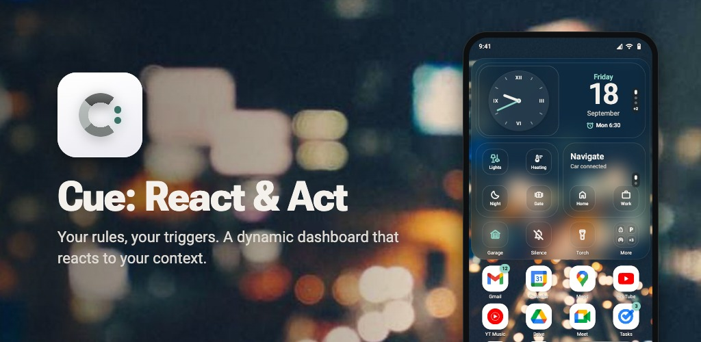

# Cue:

[](https://github.com/jaroslav-sazma/cue-launcher/actions/workflows/ci.yml)
[](LICENSE)



Cue: is an Android launcher that shows what you need right now, and you are the one who decides what
"right now" means. Every tile at the top of the home screen is a small scenario of your own: a few
conditions, and the tile that should appear while they hold. A meeting in your calendar starts and a
button to silence the phone is there; once the meeting ends, a button to turn the sound back on
takes its place. You come home and connect to your Wi-Fi, and a button to unlock the front door
appears, because Cue: can optionally talk to your own Home Assistant. Nothing is guessed or learned
behind your back: if a tile is on the screen, one of your rules put it there, and when the rule
stops holding, the tile goes away.

Around those tiles is a calm launcher that stays the way you set it up: apps and widgets the
launcher never rearranges, a dock, a scrollable widget page with a dock of its own, and an app
drawer with search.

- **Private by design.** No account, no ads, no telemetry. Everything happens on the phone; the only
  network traffic goes to your own Home Assistant, if you set one up.
- **Asks only when it needs to.** A permission is requested when you set up the thing that needs it,
  and saying no turns off just that one thing.
- **One file for everything.** Your setup, scenarios included, exports to a single file — a backup,
  or a scenario to share with someone else.
- **Phones with Android 17 or newer.** In English and Czech. Free software under GPL-3.0-or-later.

**[More screenshots](fastlane/metadata/android/en-US/images/phoneScreenshots/) ·
[Download](#download-and-install)** · coming to Google Play as "Cue: React & Act"

> **Why it exists.** It began with one mute button: silence the phone before a meeting, turn the
> sound back on afterwards — without two permanent tiles for it and without yet another widget on a
> pile of them. So the button became a rule, shown only while it is the thing I need. Other rules
> followed the same shape: headphones connect, so a music widget is at hand; I arrive home, so a
> button to unlock the door appears — and for that one, Home Assistant. Around those rules grew the
> launcher I wanted for myself: a home screen for what matters right now, a widget page for
> planning, work and reading, and a searchable drawer for everything else. Since I was building it
> anyway, it may as well be out here for anyone who likes this way of using a phone.
>
> **Why it is free.** I don't want anything back from it — no money and no data about you. That is
> why there are no ads, no paid version and no telemetry, and why nothing runs in the background
> unless something you switched on needs it. The GPL keeps it that way: anyone may build on Cue:,
> but what they hand out has to stay open as well, under a name of its own. So if anyone ever asks
> you to pay for Cue: or a copy of it, you can have the same thing here for free.

## Contents

**Using Cue:**

- [How it works](#how-it-works)
- [Finding your way around](#finding-your-way-around)
- [The home screen](#the-home-screen)
- [The widget page](#the-widget-page)
- [The app drawer](#the-app-drawer)
- [Launcher settings](#launcher-settings)
- [Scenarios](#scenarios)
- [Home Assistant](#home-assistant)
- [Example scenarios](#example-scenarios)
- [Creating scenarios in an AI chat](#creating-scenarios-in-an-ai-chat)

**Reference**

- [Backups and sharing](#backups-and-sharing)
- [Scenario file format](docs/scenario-format.md)
- [Permissions](#permissions)
- [Battery and background](#battery-and-background)
- [Privacy and security](#privacy-and-security)

**The project**

- [Download and install](#download-and-install)
- [Roadmap](#roadmap)
- [Contributing](#contributing)
- [License](#license)

---

## How it works

A **scenario** is one rule: *when* something holds, *show* this tile.

```
WHEN   a calendar event is in progress
SHOW   a small tile "Silence" — one tap switches the phone to vibrate and turns on Do Not Disturb
```

The tile appears as the meeting starts and goes away as it ends. Add a second scenario — *when the
phone is silent, show "Turn the sound on"* — put both in the same place, and the two become one
button that always offers what makes sense right now.

Everything else follows from three ideas:

- **A condition is a state or an event.** A state lasts — you are on your home Wi-Fi, the phone is
  charging — and the tile stays exactly as long as the state does. An event happens at one moment —
  a notification arrives, the doorbell rings — and the tile stays for a time you set: a minute, an
  hour, a day.
- **A tile** comes in one of three sizes and carries one or more buttons, a line of text, one of the
  launcher's own widgets (clock, calendar, media player) or any app widget.
- **Where a tile lands** is decided by its priority: the higher, the further left. A tile you want
  to find without looking can be fixed to one place instead.

A scenario without any condition is **static content**: it shows whenever nothing triggered needs
its space, so the area never sits empty. A fresh install starts with one, the clock in the large
tile.

---

## Finding your way around

Cue: has four places: the **home screen**, the **widget page** to its left, the **app drawer** and
the **launcher settings**.

```
                            ┌──────────────────────────────┐
                            │  large tile  4×2             │
   WIDGET PAGE         ◀────├───────────────┬──────────────┤────▶  an action you choose
   swipe left-to-right      │  medium  2×2  │  medium  2×2 │       swipe right-to-left
                            ├────┬────┬─────┴──┬───────────┤
                            │1×1 │1×1 │ 1×1    │ 1×1       │   ◀── dynamic area:
                            ╞════╧════╧════════╧═══════════╡       tiles from your scenarios
                            │  apps, folders, widgets      │
                            │  4 × 3                       │   ◀── static area:
                            ├──────────────────────────────┤       stays where you put it
                            │  dock  4                     │
                            └──────────────────────────────┘
                                 ▲ swipe up → app drawer
                                 ▼ swipe down → notifications
```

| Gesture | What it does |
|---|---|
| Swipe up, anywhere | opens the app drawer |
| Swipe down | opens the notification shade |
| Swipe from left to right | goes to the widget page |
| Swipe from right to left | runs the action you pick in the settings — opening an app you reach for often, say; nothing until you pick one |
| Long-press an empty spot | *Home screen options*: add an app, a widget or a folder, change the wallpaper, open the **Launcher settings** |
| Long-press an icon, a tile or a widget | its own menu |

On the first start Cue: offers to become the default home app, or to be just tried out first. It
does not start empty: the dock holds your phone, messages, camera and browser apps, the large tile
shows the clock and the widget page the calendar — all of it yours to change.

---

## The home screen

### The dynamic area

The top half belongs to your scenarios. Its shape never changes — one large tile (4×2), two medium
(2×2) and four small (1×1) — only what is in it does.

- **Each size is a queue.** Running scenarios fill the slots of their size from the left, the
  highest priority first. A tile in an ordinary slot is simply a button: a tap runs its action.
- **The last slot of each size takes what does not fit.** In the large and the medium size it turns
  into a **stack**: swipe up or down on it to flip through the tiles, while a `+N` badge and dots
  show how many there are. The swipe works over an app widget too — the widget keeps its taps and
  its own scrolling. The last small slot turns into a **folder**: a tap opens the remaining buttons
  as a list, because a tile that small is too fiddly to swipe.
- **Static content fills the rest.** Scenarios without conditions stand at the end of every queue,
  so a slot shows them whenever nothing triggered needs it.
- **A tile that cannot show its value does not show.** When a tile's text needs something that is
  not there right now — a Home Assistant state that will not load, a value missing from a
  notification — the tile steps aside and the slot shows whatever is next, rather than an empty or
  outdated field.
- **Closing a tile early.** A tile that an event brought up can be closed before its time runs out:
  long-press it → **Close**. A tile that follows a state stays until the state ends.

A tile from a notification also picks up the notification's **progress bar** (a delivery on its way,
a ride, a timer) and its **reply field**: long-press → **Reply**. A launcher widget in a tile has
its **Widget settings** in the same menu.

How the queue decides, and how to fix a tile to one place, is under
[Priority and position](#priority-and-position).

### The static area and the dock

Below the tiles is an ordinary home screen: a grid of 4 × 3 and a dock of four. It holds apps,
folders, app widgets and the launcher's search bar, and **the launcher never rearranges it** — not
when a tile comes or goes, and not when you uninstall an app: that leaves a gap, and reinstalling
the app does not fill it back in.

- **Add an app**: long-press an empty spot → *Add an app*, or long-press an app in the drawer → *Add
  to the home screen*.
- **Move** an icon by dragging it. **Long-press** it for the app's shortcuts, *Move to a folder* and
  *Remove*.
- **Folders**: long-press an empty spot → *New folder*; long-press the folder to rename it. Inside
  an open folder, long-press an app to move it left or right, or out of the folder.
- **Widgets**: long-press an empty spot → *Add a widget*. Only widgets that fit are offered, the
  launcher's own search bar among them.
- **Lock the layout** in *Appearance & features* once it is the way you want it: nothing can then be
  moved, added or removed by accident.

---

## The widget page

Swipe from left to right on the home screen and you are on a page just for widgets: a scrollable
column of as many as you like, in the order you like, with a dock of four apps of its own at the
bottom. The idea is to keep the home screen light and give the organised side of your day a place of
its own — mail, calendar, tasks, notes — and to keep the apps that belong with them, or the ones you
read your news in, in its dock.

- **Add a widget** with the button at the end of the column. A fresh install starts the page with
  the launcher's calendar; remove it and it stays removed.
- **Long-press a widget** to move it up or down, remove it, open its settings, or **Change the
  height**. App widgets start the full width of the page and two rows tall; the handle that appears
  under the widget makes it taller or shorter by whole rows. Hold the handle at the bottom edge and
  the page scrolls along, so a widget can grow past the fold. Tap anywhere else or press back when
  you are done. The launcher's own clock and calendar keep their size.
- **The dock** shows four dashed outlines while it is empty. Long-press one → *Add a shortcut*; the
  outlines go away with the first app.

Moving between the two pages is a step in depth: the home screen sinks back and blurs while the
widgets come forward one after another, and the wallpaper drifts a little the other way. The home
screen always shows exactly the part of the wallpaper you chose in Android's wallpaper picker; the
wallpaper only moves when the picker kept some spare width beside it, and with animations turned off
in the system settings it stays still.

---

## The app drawer

Swipe up anywhere. The search field sits right above the keyboard: type a few letters and press
Enter to launch the top result, the one marked with ↵.

- **Search is forgiving.** It ignores case and diacritics and copes with a typo or with letters
  taken from the middle of a name.
- **It learns from you, on the phone.** An app you often launch from search moves up for the letters
  you type, so `no` can find OneNote ahead of the apps that merely begin with "no". A fully typed
  name still always wins, a typo never overtakes an exact match, and a single letter is ordered by
  how a name starts. The history never leaves the phone and can be cleared in the settings.
- **Everything else is a scroll away**: below the results, all apps from A to Z, with an index along
  the side for jumping.
- **Long-press an app** to add it to the home screen or to hide it. A hidden app is gone from search
  and from the list, but its icon on the home screen stays; *Appearance & features → Hidden apps*
  brings it back.
- **Optional rows**, in *Appearance & features → Drawer*: contacts in the results, with buttons to
  call or message (asks for contacts access); an **Ask AI** row that hands the query to your
  assistant app only when you tap it; and a **Search the web** row when nothing matches.

Cue:'s own entry in the drawer opens the launcher settings while Cue: is the default home app.
Anywhere else — another launcher, the store, while you are only trying Cue: out — it opens the Cue:
home screen.

---

## Launcher settings

Long-press an empty spot on the home screen → **Launcher settings**. There are three tabs:

- **Scenarios** — your scenarios and the **+** button for a new one (see [Scenarios](#scenarios)).
  Its **⋮** menu holds *Import*, **Home Assistant** (see [Home Assistant](#home-assistant)) and
  *About*, with the version, the licences and *Report a bug*.
- **Appearance & features** — how the launcher looks and behaves, below.
- **Backups** — exporting and restoring (see [Backups and sharing](#backups-and-sharing)).

### Appearance & features

| Setting | What it does |
|---|---|
| **Icons** | *Native icons* as the apps draw them, an installed *Icon pack*, or *Tinted mode* — monochrome silhouettes for a calmer screen. An icon that does not suit tinting can be set back to native from its long-press menu. Tiles in the dynamic area always draw tinted glyphs, whatever is set here. |
| **Accent colour** | the colour of highlights: a lit Home Assistant entity, notification badges, the clock hands, today in the calendar, progress bars. *Main* and *Second* come from the Material You palette Android builds from your wallpaper and follow light and dark mode; *Custom* is a `#RRGGBB` colour of your own, used as it is in both. The settings screens keep the system colours. |
| **Reduced transparency** | solid surfaces instead of frosted glass, with no blur. |
| **Notification count badges** | off by default. The number of an app's notifications on its icon — on the home screen, in both docks, in an open folder and in the drawer; a closed folder shows a dot instead, and tiles never get either. Badges follow Android's own rules: nothing shows while *Notification dot on app icon* is off in the system, for an app whose dots are off, or while Do Not Disturb hides them. Asks for notification access. |
| **Drawer** | contact search, the *Ask AI* and *Search the web* rows, hidden apps, clearing the launch history. |
| **Gestures** | what the right-to-left swipe on the home screen does: any action from the [action sheet](#actions), or nothing. Swiping up always opens the drawer. |
| **Lock the layout** | icons, folders and widgets can no longer be moved, added or removed. |
| **Create scenarios in an AI chat** | experimental, off by default — see [Creating scenarios in an AI chat](#creating-scenarios-in-an-ai-chat). |

There is no font setting on purpose: Cue: draws all its text in the system font and follows the
system font size; above 120 % the icon labels step aside rather than crowd the grid. Cue: speaks
English and Czech. It takes whichever of the two comes first in the phone's list of languages, and
English when neither is there; to use the other one for Cue: alone, pick it in *Settings → System →
Languages → App languages*.

### Widget settings

The launcher's own search bar, calendar and media widget carry **Widget settings** in their
long-press menu, the same entry an app widget has:

- **Search bar** — what a tap does. By default it searches in the browser.
- **Calendar** — what a tap does (by default it opens your calendar app) and which calendars it
  reads. By default those are the ones visible in your calendar app; a pick of your own can include
  a calendar hidden there.
- **Media** — which player it follows. YouTube Music until you pick another; the list holds the apps
  that let other apps control their playback.

The settings belong to the widget, not to one copy of it, so a change applies wherever it sits: home
screen, widget page or a tile. The player is part of a backup; the calendar choice is not, because
calendars are tied to one phone.

---

## Scenarios

### Creating a scenario

*Launcher settings → Scenarios → **+***. The builder takes five steps:

1. **When it shows up** — the conditions, or none for static content, and an optional name.
2. **Which tile** — large, medium or small.
3. **What shows up** — the content, and what a tap does.
4. **Priority and position** — see [Priority and position](#priority-and-position).
5. **Summary** — every row reopens its step; then **Save the scenario**.

While you edit a condition, the builder tells you whether it holds right now — *✓ holds now* or *✗
does not hold now* — so you see at once whether you got it right. Leaving a scenario you have not
saved asks first. A scenario can be switched off without deleting it.

The list groups the scenarios by size and orders each group by priority; drag a row to change its
priority. Each row spells its conditions out as a sentence, such as *18:00–23:00 ∧ Wi-Fi Home*. An
open scenario shows how it stands right now — its conditions hold, it waits for an event, or which
condition does not hold — and which scenarios outrank it in the queue. Its menu offers *Edit*,
*Duplicate*, *Export* and *Delete*.

There is also a second way in: describe the scenario to an AI chat and paste its answer back — see
[Creating scenarios in an AI chat](#creating-scenarios-in-an-ai-chat).

### Conditions

A condition is one of two kinds:

- **A state** holds for a while: *Wi-Fi Home*, *charging*, *18:00–23:00*. The tile is there for
  exactly as long as the state lasts.
- **An event** happens at one moment: a notification from the parcel app, the doorbell, the alarm.
  It has no length of its own, so you set **how long the tile stays visible**: 30 s, 60 s, 5 min or
  any number of minutes (`1.5` works too). The same event arriving again restarts the countdown
  instead of adding a second tile.

Every state condition opens with a **Holds when** switch that turns it around: *charging* or *not
charging*, *Wi-Fi Home* or *away from Wi-Fi Home*. Turning a condition around does not help one Cue:
cannot read, though: without the permission it needs, it stays unknown either way.

**Several conditions.** From the second condition on, a switch above the list says how they combine:

- **all at once** (the default) — every condition has to hold. *18:00–23:00 **and** Wi-Fi Home* is
  an evening at home. At most one event fits here, because two events never arrive at the same
  instant.
- **any of them** — one is enough. *Charging **or** Wi-Fi Home*. Any number of events can join, and
  whichever arrives decides how long the tile stays. When a state and an event are both in, the
  event shows the tile for its time, and if the state starts holding in the meantime, the tile stays
  until the state ends.

Adding a second event to a lone event switches the scenario to *any of them* by itself.

#### Holds while the state lasts

| Condition | Holds while | Example | Needs |
|---|---|---|---|
| **Time window** | the time is between *from* and *to*, on the days you pick; a window may cross midnight | weekdays 07:00–09:00 → your transit app | — |
| **Bluetooth connected** | any device, or the one you pick, is connected. The pick offers the paired devices too, so the car does not have to be around | the car's handsfree → navigation buttons | Bluetooth permission |
| **Wi-Fi** | the phone is on any Wi-Fi, or on the network you name | Wi-Fi *Home* → buttons for the house | location, only for a named network |
| **Charging** | the phone is charging | charging → a button for the alarms | — |
| **Headphones or speaker** | an external audio output is connected | headphones → your music app | — |
| **Something is playing** | any app plays, or one of the apps you tick. A pause shorter than a minute does not count as stopping | YouTube Music plays → the media widget | notification access |
| **Ringer mode / do not disturb** | the phone is silent, on vibrate, ringing, or in Do Not Disturb | silent → "Turn the sound on" | — |
| **Calendar event** | any calendar event is in progress | a meeting → "Silence" | calendar |
| **Home Assistant — state** | an entity is in one of the states you pick | the TV is `playing` or `paused` → its remote | Home Assistant connected to Cue: |

#### Happens at a single moment

| Condition | Fires when | Example | Needs |
|---|---|---|---|
| **A moment in time** | the next alarm rings (*At the alarm*), or at a set time on the days you pick (*At a set time*) | the alarm rings → weather and calendar for an hour | — |
| **Bluetooth disconnected** | any device, or the one you pick, disconnects | the car disconnects → "Remember the place" | Bluetooth permission |
| **Notification from an app** | the app posts a notification — optionally only one whose text contains what you type. Up to four values can be [pulled out of its text](#values-from-a-notification) | the parcel app, *pickup* → the pickup code | notification access |
| **Notification ended** | the app's notification goes away — optionally only an ongoing one, shown for at least a while | Google Maps ends a navigation → "Remember the place" | notification access |
| **Home Assistant — event** | your Home Assistant sends an event with the pairing code | `doorbell` → "Open the gate" | [the blueprint](#3-upload-the-blueprint-for-events) in Home Assistant |
| **A place is remembered** | a tile with *Remember the place* is tapped | → "Where I parked" for three days | — |

A few of them need a word more:

- **At the alarm** means the alarm Android shows in the status bar, usually set in the clock app.
  The countdown runs from the ring, not from when you unlock the phone. A snoozed alarm restarts the
  countdown of the tile already showing; an alarm deleted or moved fires nothing; a ring missed
  because the phone was off, or still locked after a restart, gets what is left of the time. With no
  alarm set, the condition simply waits.
- **Notification from an app** works while you are in another app too, so the tile is ready when you
  come back, and it goes away when you dismiss the notification. Android hides one-time codes from
  apps it does not trust: since Android 15, a notification in which the system detects a one-time
  password reaches Cue: with its content redacted, so a value in it cannot be read and its tile does
  not appear.
- **Notification ended** counts the app taking its notification down or you swiping it away; the
  system tidying up — an uninstall, a snooze, a channel switched off — does not. *Shown for at
  least* leaves out a notification that goes away sooner: Google Maps flashes one for a moment as a
  navigation starts. Maps takes its notification down when you arrive and switch the screen off or
  leave the app, when you arrive with the screen already off, and when you end the navigation early;
  walking navigation fires too. An end the launcher did not see — Android restarted it just then —
  fires nothing. The tile can show `{notif:title}` and `{notif:text}` of the notification's last
  version.
- **A place is remembered** keeps the place for as long as its tile: when the time runs out or you
  close the tile, the place is forgotten, and it is never exported. Saving again replaces the place
  and restarts the countdown. The place is read at the tap, while the home screen is on, so wait for
  the tile to change before you lock the phone; leaving earlier cancels it and nothing is saved.
  With only approximate location allowed, the place is approximate too. The tile can show it as
  `{place:lat}` and `{place:lng}`.
- **Home Assistant — state** is followed while the home screen is shown, and read once more when an
  event fires a scenario that also depends on it. While Home Assistant cannot be reached, does not
  answer in time or reports the entity `unavailable` or `unknown`, the condition is unknown and the
  tile stays hidden, turned around or not — see [A state as a condition](#9-a-state-as-a-condition).

**An event's tile ends** when its time runs out, when you close it (long-press → Close), when the
notification that brought it is dismissed, or — for a Home Assistant event — when an end event with
the same code arrives. If Android ends the launcher in the meantime, an event's tile comes back with
the time it had left, and every state is checked afresh whenever you return to the home screen.

### Values from a notification

A *Notification from an app* condition can pull up to four values out of the notification's title
and text and put each on the tile, so a parcel tile reads just the pickup code instead of the whole
message. A value is described by what stands before it and what it looks like — no pattern language:

```
extract:  [ { "name": "code", "after": "pickup code", "kind": "number" } ]
template: "Pickup code {notif:code}"
```

In the builder this takes no typing. Under the condition, **Pick from a notification** lists the
app's current notifications, or **Type or paste a sample** takes one by hand, with the title on the
first line. The sample turns into tappable words; tap the value you want — the code, the amount —
and the builder adds the rule that reads it, picking the kind from what the value looks like. A
value that runs on into the next sentence of the same line is offered as *text up to a marker*. The
words the rule looks for come from the same line or the line above, never from the title, so a
sender's name does not end up in the scenario. The result is shown live on the sample and, for a
picked notification, counted over the app's current notifications; every part of the rule stays
editable. A tap on the first word of a value already pulled removes its rule, a tap further inside
adds a new one. The sample lives only in the open form: it is not saved with the scenario and never
logged.

The builder offers eight kinds of value — number, code, amount, time, date, word, line and text up
to a marker. What each of them reads, with an example notification, and how the text a value follows
is matched are described in
[the scenario format](docs/scenario-format.md#values-from-a-notification).

### What a tile shows

| Content | Size | What it is | Example |
|---|---|---|---|
| **Icon with an action** | 1×1 | one icon with a caption; a tap runs the action | *Silence* |
| **Text only** | 2×2 | one or two lines of text; the whole tile is the button | *Pickup code 482 913*, opening the carrier's app |
| **Text + 2 icons** | 2×2 | a line of text over two buttons, each with a short label | *Navigate* over *Home* and *Work* |
| **4 icons** | 2×2 | four buttons, each with a short label | *Lights*, *Heating*, *Night*, *Gate* |
| **Launcher clock** | 4×2 | a dial, the date and the next alarm; a tap opens the alarms | the clock on the charger at night |
| **Launcher calendar** | 4×2 | the month and the three nearest events, each dotted in its calendar's colour | the morning after the alarm |
| **Launcher media** | 4×2 | what the player you picked is playing, with previous, play/pause and next | headphones connected |
| **App widget** | 1×1, 2×2, 4×2 | any widget an installed app offers | a weather widget in the morning |

About a dozen characters fit a label inside a button before it is cut; an icon without one shows the
glyph alone.

**The media widget** follows only the player picked in its *Widget settings*, never anything else
that plays. A button the player does not offer right now is greyed out, and a tap outside the
buttons opens the player. While that player has nothing loaded, all three buttons are grey and a tap
only opens the app: no launcher can start playback in another app, so the first play happens there.
It needs notification access to see what is playing.

**App widgets** are bound once, through the standard Android dialog; from then on Cue: shows and
hides the widget by your conditions. While they do not hold, the widget does not exist at all, so it
costs no memory and no battery. Whenever a widget comes into view, Cue: asks its app for fresh
content — at most once every 30 seconds and never while you are not looking — but what arrives is up
to the app: one that answers shows current data at once, one that ignores the request shows whatever
it last sent. There is no widget maker: the templates stay minimal, and anything richer is someone
else's widget hosted here.

#### Values inside the text

Write `{namespace:key}` anywhere in a tile's text and the value is filled in when the tile is drawn:

| Placeholder | Source | Example |
|---|---|---|
| `{ha:temperature}` | a field from the payload of the Home Assistant event that fired | `Done in {ha:remaining} min` |
| `{ha:sensor.outside_temperature}` | a key containing a dot is an entity id — read from your instance while the tile should be visible, and followed live while the launcher is on screen | `Outside {ha:sensor.outside_temperature} °C` |
| `{notif:title}`, `{notif:text}` | the notification that fired, or the last version of the one that ended | `{notif:title}` |
| `{notif:code}` | a value pulled out of the notification, under the name its rule gives it — see [Values from a notification](#values-from-a-notification) | `Pickup code {notif:code}` |
| `{place:lat}`, `{place:lng}` | the place an *A place is remembered* tile holds, in degrees | `{place:lat}, {place:lng}` |

If a value cannot be filled in, the tile is not shown and the slot falls through to what is behind
it; a tile never shows a stale number.

### Actions

Every tap is picked from the same action sheet — the buttons of a tile, the search bar and the
calendar widget (through their *Widget settings*), and the right-to-left swipe.

| Action | What it does | Example |
|---|---|---|
| **Open an app** | launches an installed app | your music app |
| **Something in an app** | one of the things the app offers, in sections: *App shortcuts* (what you see when you hold its icon), *Shortcuts you pick in the app*, *Links into the app*, *What the app can do* (actions it publishes for assistants) and *App screens* | Outlook's calendar picked in the app; Chrome's search screen |
| **System action** | the catalog below | *Flashlight* |
| **Home Assistant action** | a service call on your instance, optionally only after a fingerprint — see [Actions and states](#8-actions-and-states) | `light.turn_off` on `light.living_room` |
| **Custom link (URI)** | opens any address an app understands | `google.navigation:q=Prague`, `spotify:search` |

App shortcuts, shortcuts you pick in the app and what the app can do need Cue: to be **the default
home app**: Android lets only the current launcher read them. Until it is, those sections are left
out and the sheet says why; links and app screens work regardless. *Shortcuts you pick in the app*
open the app first, you choose the target there — a calendar, a settings page, a route — and the
launcher keeps what comes back. One the scenario format cannot hold is turned down with a note
rather than saved half-way.

A link can also be a serialized intent starting with `intent:` or `android-app:` — the form Home
Assistant hands out, and the only one that can name a target app. So
`intent://devices/controller?hgs_device_id=…#Intent;scheme=googlehome;package=com.google.android.apps.chromecast.app;end`
opens the Google Home controller. Everything such an intent could reach beyond opening an app is
taken away first: file permission grants are stripped, a link to a `file:` or back into the launcher
itself is refused, and when the intent names a `browser_fallback_url` and its app is not installed,
that web address opens instead.

#### System actions

| Group | Actions | Notes |
|---|---|---|
| **Sound** | *Silent mode*, *Vibrate*, *Turn the sound on*, *Turn Do Not Disturb on*, *Turn Do Not Disturb off* | need the special *Do Not Disturb access*. Android ties the ringer to Do Not Disturb: silent mode turns it on, vibrate and sound turn it off |
| **Device** | *Flashlight*, *TV remote* | the flashlight is a toggle. *TV remote* opens the remote of the Google TV app, like that app's tile in Quick Settings: pick a TV, then control it. Without the Google TV app it is not offered, and a tile that carries it only says the app is missing |
| **Place** | *Remember the place*, *Show the remembered place* | *Remember the place* reads where the phone is at the tap — once, on screen, never in the background — for the scenarios that wait for *A place is remembered*; if none waits, nothing is saved and it says so. It needs location, asked at the first tap; approximate is enough. *Show the remembered place* opens it in the maps app |
| **Panels** | *Volume panel*, *Internet panel*, *Wi-Fi panel*, *NFC panel*, *System settings* | the system's own panels and settings |

**What "Do Not Disturb (Cue:)" is.** Since Android 15 no app can switch the system's Do Not Disturb
itself: Android creates a mode of the app's own instead, listed in *Settings → Notifications →
Modes* as *Do Not Disturb (Cue:)*. Cue: keeps it only while it is on — switching it off in any way
deletes it, and the next *Turn Do Not Disturb on* creates it again as a copy of your ordinary *Do
Not Disturb* settings. So set who may get through in the ordinary *Do Not Disturb*; changes to *Do
Not Disturb (Cue:)* last only until it is off. *Turn Do Not Disturb off* lifts only that mode: a Do
Not Disturb you switched on by hand, a bedtime schedule or the one *Silent mode* brought along stays
on. *Vibrate* and *Turn the sound on*, on the other hand, end every Do Not Disturb, as Android does
for any app — though one that another app or a schedule started is only paused until the next
restart.

Android does not let any app switch Wi-Fi or Bluetooth directly (open the panel instead) or press
another app's Quick Settings tile (use a link to that app's screen).

#### Several actions on one tap

One button can run a **list** of actions, in the order you set. That is how "silence for a meeting"
becomes one tap, although Android splits it into two switches:

```json
"action": [
  { "kind": "system", "action": "ringer_vibrate" },
  { "kind": "system", "action": "dnd_on" }
]
```

All of them run even when one fails, only the first failure is reported, and the first action
decides the icon. The one exception to the order is *Turn Do Not Disturb on*: it always runs last,
because a ringer change after it would end Do Not Disturb again.

### Priority and position

**Priority** is a whole number, 0 or more; the higher, the further left. It is only compared within
one size, and a tie goes to whichever scenario started later. Static content always stands behind
the scenarios with conditions.

> Two medium slots, and three medium scenarios running at priorities 900, 800 and 700: the first
> slot shows 900, the second — the stack — shows 800 with `+1`, and 700 is one swipe away. When 900
> ends, 800 moves to the first slot and 700 comes to the front of the stack.

**Position** is *Floating* by default: the priority places the tile. A medium or small scenario can
instead take a **Fixed position** — it always shows in the slot you picked and the rest flows around
it. That is for the one button you want to press without looking.

- **Which slots.** A small tile can be fixed to the 1st, 2nd or 3rd slot, a medium one to the 1st.
  The large size has a single slot, so there is nothing to fix. The last slot of a size is never
  offered: what does not fit needs a way in.
- **A slot is shared, never owned.** Any number of scenarios can be fixed to the same slot.
  Whichever of them is running is drawn there; when more are, the same order as in the queue decides
  — a scenario with conditions before static content, then the higher priority, then the later
  start.
- **Only while it runs.** A fixed slot is held only while its scenario is running; otherwise the
  queue fills it as usual. A scenario that loses a shared slot takes the next free one like a
  floating tile.
- **It keeps its slot even with nothing in front of it**, so a slot to its left can stay empty. That
  is the price of the tile never moving; static content usually fills the gap.
- The home screen does not mark a fixed tile. The scenario list does — *pinned to position 1* —
  because such a scenario no longer follows the list's order.

> **A toggle that never moves.** *Meeting → Silence* (a calendar event) and *Silent → Turn the sound
> on* (ringer mode: silent), both small and fixed to the first slot. During a meeting the button
> silences the phone; once it is silent, the same place offers to turn the sound back on.

### Icons and colour

A button's icon comes **from its action** — an app's own icon, a system action's glyph, the glyph
from a Home Assistant event, or `mdi:home-assistant`. Any of them can be replaced from the full
**Material Design Icons** set, about 7,000 glyphs under the same names Home Assistant uses, so
`mdi:gate` is what you would expect.

All tiles share one design: the same glass, the same shape, single-colour glyphs. An app icon in a
tile is drawn tinted too, whatever the *Icons* setting says; that setting is for the home screen,
the docks and the drawer.

The **accent colour** marks a Home Assistant entity whose state is "active": a gate icon lights up
while the gate is `open`, `on`, `opening`, `playing`, `home`, `unlocked`, `heat` or `cool`, and goes
back to normal otherwise. Every icon answers for itself, so a tile with four Home Assistant buttons
can have the gate lit and the lamp not.

The entity that counts is the one the action calls, unless the action names another in **Icon state
from**. That one replaces it: a door button that runs `lock.open` on `lock.front_door` with *Icon
state from* `binary_sensor.front_door_contact` lights up while the contact reports the door open,
and the lock's own state no longer matters for the icon. A value there that is not one valid entity
id leaves the icon in the ordinary colour. Note that an entity behind an icon is then read from your
instance, in the same burst as the tile's other values.

A notification that declares a style — info, safe, caution, danger — passes that colour to the icons
of its tile, but a lit entity keeps the accent anyway: what is true right now outranks the mood of
the message.

---

## Home Assistant

Cue: works with your own [Home Assistant](https://www.home-assistant.io/) in two independent
directions, and either one works alone:

- **Home Assistant tells Cue: that something happened** — the doorbell rang, the washer finished —
  and a tile appears. This is the *Home Assistant — event* condition. It travels through the Home
  Assistant companion app you already have, so it needs no address and no sign-in in Cue:, and it
  works at home and away alike.
- **Cue: talks to Home Assistant** — a button switches off a light or opens the gate, a tile shows
  the outside temperature, a scenario waits for the TV to play. For this, Cue: needs your instance's
  address and a sign-in.

| | Channel | Used for | Needs |
|---|---|---|---|
| **Events → launcher** | the companion app fires an Android broadcast | the *Home Assistant — event* condition | the companion app, plus the pairing secret. **No** URL, **no** token |
| **Launcher → HA** | the launcher calls your instance directly | Home Assistant actions, `{ha:entity.id}` values, the *Home Assistant — state* condition | your Home Assistant address and either a sign-in or a long-lived token |

**The shortest way:** *Launcher settings → Scenarios → ⋮ → Home Assistant* → **Find my Home
Assistant**, pick your instance → **Sign in to Home Assistant** → **Test the connection**. For
events, tap **Upload the blueprint to automations**, create an automation from it in Home Assistant,
and give a scenario the *Home Assistant — event* condition with the same pairing code. The steps
below explain each part. If you only want event tiles, the connection can be skipped: import
[`ha/launcher_event.yaml`](ha/launcher_event.yaml) into Home Assistant yourself, copy the pairing
secret from this screen into it, and go on with
[step 4](#4-create-an-automation-from-the-blueprint).

### 1. Find your instance

Tap **Find my Home Assistant**. Android shows its own picker with every Home Assistant that answers
on the local network; pick yours and the launcher fills in the **address at home** (the instance's
`internal_url`, or its address and port), the **address away from home** when the instance publishes
an `https://` `external_url`, and the instance's identity, so the launcher can tell later whether
you are home. Picking the instance is also what gives the launcher access to it — Android 17 blocks
the local network for apps without access, and a service you picked yourself is enough, with no
permission dialog.

If your instance is not on the same network (a different VLAN, a VPN, no mDNS), close the picker and
type the addresses in. The launcher then needs the **local network** permission for a local address,
and a button right under the fields asks for it.

| Field | What goes in | Notes |
|---|---|---|
| **Address at home** | `http://homeassistant.local:8123` | plain HTTP is allowed for a **local** address (a `.local` name, a private or a Tailscale IP) and only on a network the launcher recognises as yours; a public host must be `https://` here too |
| **Address away from home** | `https://your-account.ui.nabu.casa` | **must** be `https://` — Nabu Casa, a reverse proxy, or a Tailscale address |
| **Home Wi-Fi** | your network names, comma-separated | not needed once an instance is paired through the picker. May also be a BSSID as `BSSID:aa:bb:cc:dd:ee:ff`. Reading the network name needs location permission |

Either address alone is enough. With both, Cue: uses the home address at home and the other one
elsewhere, and **remembers which one actually worked** on each network, so a Tailscale-only or
split-DNS setup settles after the first call.

"Am I home?" has two answers, and either is enough: the Wi-Fi is one you listed, or the paired
instance answers on the local network right now. Both only decide whether an `http://` home address
may be used, and neither is proof: a network name can be copied by anyone who raises an access
point, and the instance's identity is announced openly on your home network, so someone who has seen
it there could announce it elsewhere. A `BSSID:` entry is harder to fake than a name, but only helps
while no instance is paired, since either answer is enough. An `https://` home address takes the
question off the table — TLS proves who answered, wherever you are.

### 2. Sign in (or paste a token)

The switch under the addresses picks one of two ways in:

- **Sign in** (the default) opens your instance in a browser tab; you log in as usual and the tab
  closes itself when it is done. The launcher keeps a *refresh token*, and the tokens it actually
  sends expire after 30 minutes. You can end the session at any time in **Home Assistant → your
  profile → Security → Refresh tokens**, where it shows as `http://127.0.0.1:…/cue-launcher`.
- **Token** takes a long-lived access token from **your profile → Security → Long-lived access
  tokens**, for when you would rather not sign in or the browser cannot reach your instance.

Either is stored encrypted and never exported, and saving one clears the other. A session you
replace — by signing in again or pasting a token — or remove is ended in Home Assistant too; when
the instance cannot be reached at that moment the launcher says so, and the session stays valid
until you remove it under *Refresh tokens*. A long-lived token is different: you created it and may
use it elsewhere, so replacing or removing it in the launcher only forgets it on the phone. It stays
valid until you delete it under *Long-lived access tokens*.

The address fields are stored only when you confirm them with the **Save** bar that appears once you
edit them; signing in counts as confirming. **Test the connection** reports for each address the
HTTP status, the time it took and how many entities it can see. An `http://` home address is **not**
contacted while you are away — the test says so instead, because the token would otherwise travel in
the clear to whatever answers that name on a foreign network.

### 3. Upload the blueprint (for events)

On the same screen, tap **Upload the blueprint to automations**. The launcher saves the blueprint
straight into Home Assistant with your pairing secret already filled in, and it appears under
**Settings → Automations & scenes → Blueprints**, titled with the phone's name — *Cue: — event into
the launcher (Pixel 10 Pro)* — in Czech when Cue: runs in Czech, in English otherwise. Nothing is
written on the phone and no storage permission is involved. The source is in the repository:
[`ha/launcher_event.yaml`](ha/launcher_event.yaml) and its Czech twin
[`ha/launcher_event.cs.yaml`](ha/launcher_event.cs.yaml), which differs only in the text.

Each phone gets a file of its own, `blueprints/automation/cue/launcher_event_<code>.yaml` — the only
file the launcher ever writes there — so two people on one instance never overwrite each other's
blueprint. Uploading again replaces it, and Home Assistant reloads the automations built from it.
The code follows the phone, not the secret: a new phone, a factory reset or a differently signed
build gets a second blueprint under the same title, and the automations built from the old one stay
with it. Uploading needs a Home Assistant **administrator** account, Home Assistant **2024.10** or
newer and the companion app on the phone.

Above the button is the **pairing secret**, a 16-character string the launcher generates. An Android
broadcast that another app can send is open to *every* app on the phone, so an event without the
right secret is thrown away; that is what stops another app from putting a tile of its own invention
on your home screen. The blueprint carries the secret as the default of its *Pairing secret* field,
so **after the secret changes, upload the blueprint again** and every automation that left the field
alone picks up the new value; one where you typed a secret of its own has to be edited by hand.

The field is editable, which makes a **reinstall or a new phone** painless: type in the secret your
automations already use and tap *Save the secret*. It needs at least 8 characters of plain ASCII, no
comma, colon or space (the companion app splits on them) and at least one letter (a value of digits
only is read as a number and the whole event is dropped). Case matters. *Generate a new one* makes
the old secret stop working until the blueprint is uploaded again, so only reach for it if the
secret leaked.

### 4. Create an automation from the blueprint

| Blueprint field | What goes in |
|---|---|
| **Trigger** | whatever should raise the event — a doorbell press, an entity state, a finished washer |
| **Conditions** | optional; when the event actually gets sent (only when you are home, for instance) |
| **Phone** | pick the phone from the list — the notify service is derived from it |
| **Pairing secret** | already filled in by the upload — leave it as it is |
| **Pairing code** | any word, e.g. `doorbell` — **no commas, no colons**; case and surrounding spaces do not matter |
| **What the event does** | *Start* (the tile appears) or *End* (the tile disappears now) |
| **Tile icon** | optional MDI glyph name — `doorbell` or `mdi:doorbell`, the prefix is stripped for you |
| **Payload for the template** | name/value pairs: `temperature` → `38`. HA templates work in a value; a name may carry no comma and no colon, and `secret`, `code`, `op`, `icon` and `v` are taken by the event itself — see [the example](#7-example-payload) for how to fill it in |
| **Notify service** | leave empty; only for a phone whose companion service is not `notify.mobile_app_` plus its device name |

### 5. The matching scenario in the launcher

In the builder pick the condition **Home Assistant — event**, type the **same pairing code**, set
how long the tile should stay, and build the tile as usual. Payload fields become
`{ha:temperature}`, `{ha:program}` and so on.

### 6. Example: doorbell

**In Home Assistant**, from the blueprint: trigger = `binary_sensor.doorbell` turns `on`, pairing
code = `doorbell`, tile icon = `doorbell`. Written by hand, the automation is just:

```yaml
alias: "Cue: doorbell"
mode: queued
triggers:
  - trigger: state
    entity_id: binary_sensor.doorbell
    to: "on"
actions:
  - action: notify.mobile_app_pixel_10_pro
    data:
      message: command_broadcast_intent
      data:
        intent_package_name: app.cue.launcher
        intent_action: app.cue.launcher.HA_EVENT
        intent_extras: "secret:ABCD2345EFGH6789,v:1,code:doorbell,icon:doorbell"
```

`secret:` is your own pairing secret from the launcher; without it the event is rejected and shows
up in the event log as *rejected*. `v:1` is the version of the contract the blueprint was written
against.

**In Cue:**, two scenarios with the same condition, *Home Assistant — event* `doorbell` for 60 s:

- a medium tile *"Someone is at the door"* with a Home Assistant action `lock.open` on
  `lock.front_gate`, priority 950;
- a small tile *"Open the gate"* with the same action, priority 940 — the one worth a
  [fixed position](#priority-and-position) in the first small slot, so whatever else fires at the
  same moment, the button stays where your thumb expects it.

To make the tiles go away the moment the gate opens, add a second automation from the same blueprint
with the **same code** and **End**.

### 7. Example: payload

In the blueprint's **Payload for the template** field, a small YAML editor in Home Assistant — one
value typed in and one read from a sensor when the event is sent:

```yaml
program: cotton
remaining: "{{ states('sensor.washer_remaining_minutes') }}"
```

Keep the template in quotes, or YAML reads `{{ … }}` as a mapping of its own. On the tile:

```
Tile text:   "Done in {ha:remaining} min"
Second line: "Program {ha:program}"
```

Written by hand, with the sensor at 12, the values are URL-encoded and marked as such, which lets
them contain a colon, a comma or a space:

```yaml
intent_extras: "secret:ABCD2345EFGH6789,v:1,code:washer,icon:washing-machine,program:cotton:urlencoded,remaining:12:urlencoded"
```

Since anyone on the phone can send the broadcast, an event is held to a few limits: a code of at
most 64 characters, at most 32 payload fields with names of up to 64 characters, and values cut at
1024 characters. A value is text, a number, or true/false; anything else is left unread.

### 8. Actions and states

A **Home Assistant action** takes a service, an optional entity, optional JSON data and an optional
entity for the icon's state:

| Field | Example |
|---|---|
| Service | `light.turn_off` |
| Entity | `light.living_room` |
| Data | `{"transition": 2}` |
| Icon state from | `binary_sensor.front_door` |

The entity and the service each have a menu filled from your instance: open it to browse, or type to
narrow it down by id or by name. The services offered are the ones that fit the entity, the way Home
Assistant's own action editor filters them; with no entity, every service is offered. Both fields
stay free text, so with the instance out of reach there is simply no menu and whatever you type is
taken as it is. Service names follow the app's language when Home Assistant has them translated.

**Icon state from** takes no part in the call; it only decides the icon's colour — see
[Icons and colour](#icons-and-colour).

**Ask for confirmation** makes the tap raise the system prompt first — fingerprint or face, with the
screen lock as the fallback — and the call goes out only once it passes. It is per action, so the
front door can demand a fingerprint while the lamp beside it stays a plain tap. On a phone with
neither biometrics nor a screen lock, the action refuses to run and says why.

**Test it now** fires the call while you are still in the builder, so a typo in an entity id shows
straight away. It is optional: an action you would rather not fire just to check it — unlocking the
front door — can be saved untested. A slow service is reported as *sent* rather than failed, and
with two addresses a call is tried on the second one only when the first connection was never made,
so a gate cannot be opened twice.

To **show a state**, put the entity id in the tile's text:
`Outside {ha:sensor.outside_temperature} °C`. At home the launcher then follows the value live for
as long as it is on screen. Away from home it reads it when the tile appears and re-reads it slowly
while you look, which spares the battery; an action you just sent pulls the next read forward. A
state that comes back `unavailable` or `unknown` counts as unreadable, and the tile gives way to
whatever is behind it.

### 9. A state as a condition

The **Home Assistant — state** condition holds while an entity is in one of the states you pick: a
TV's `media_player` while `playing` or `paused`, a door's `binary_sensor` while `on`, a `person`
while `home`. Under the entity, the builder offers the states that kind of entity reports, the one
it is in right now and any you type, and shows what Home Assistant reports while you edit. Turned
around with **Holds when**, it holds while the entity is in none of them.

The state is read when the home screen appears and then followed like a tile's value; when you come
back, the last known state stands in until the fresh one arrives, so a TV that is still playing
keeps its tile in place. An event the same scenario waits for — a notification, an alarm, a Home
Assistant event — reads just the entities that scenario names, once, and gives up after three
seconds. While Home Assistant cannot answer, the condition is unknown and the tile stays hidden.
Without a connection set up, the builder says so and offers the way to set it up.

### Gotchas

- **Do not put the icon in the payload.** The companion app reads the text after a *second* colon as
  the value's *type*, so `icon:mdi:doorbell` arrives as the value `mdi`. That is what the
  blueprint's separate icon field is for.
- **Hand-written payloads follow the companion app's rules.** A value must contain a colon at all
  (`intent_extras: "doorbell"` throws inside the companion app and the launcher receives nothing),
  and a value that itself contains a colon has to be `name:value:urlencoded` with the value
  URL-encoded, or spell the type out (`time:20:15:String`). The blueprint does this for you.
- **A value of digits only becomes a number.** A long row of digits does not fit the companion app's
  `Int`; it throws and the whole broadcast is dropped. Keep a pairing code out of digits alone for
  the same reason the secret needs a letter. A payload value from the blueprint is safe, it is
  marked as text.
- **After a force-stop, broadcasts do not arrive** until you open the launcher once. That is
  Android's "stopped state", not a bug. When debugging, kill the process with
  `adb shell am kill app.cue.launcher` instead.

### Debugging

At the bottom of the Home Assistant screen, **Pairing codes** lists every code your scenarios use,
how many scenarios wait for it and when it last arrived — a red `!` means never. Below it, a **live
event log** records incoming events, including those with an **unknown code** (a typo on the Home
Assistant side) and those with the wrong secret, logged as **rejected** — if an automation suddenly
went quiet, that is the first row to look for. Rejected rows are capped at six a minute, so a noisy
sender cannot push your real events out of the log.

Without Home Assistant, an event can be sent from a computer — the secret is required here too:

```bash
# start, with a payload for the template (an Int arrives as a number, not as text)
adb shell am broadcast -a app.cue.launcher.HA_EVENT -p app.cue.launcher \
  --es secret ABCD2345EFGH6789 --ei v 1 --es code doorbell --es icon doorbell --ei temperature 38

# end the same tile early
adb shell am broadcast -a app.cue.launcher.HA_EVENT -p app.cue.launcher \
  --es secret ABCD2345EFGH6789 --es code doorbell --es op end
```

A debug build is the package `app.cue.launcher.debug` (see [Building](CONTRIBUTING.md#building)).
The blueprints address the release app only, so events for a debug build are sent by hand, with
`-p app.cue.launcher.debug`.

---

## Example scenarios

From one condition to small chains. [`fixtures/scenarios/`](fixtures/scenarios/) holds about thirty
ready-made files in the same spirit, at least one for every condition and tile layout; import them
through *Launcher settings → Scenarios → ⋮ → Import* and fill in what belongs to your phone.

### 1. Music with headphones

**Headphones or speaker** → the large tile shows the **launcher media** widget. Plug the headphones
in and the player is at hand; take them out and the clock is back. One state, one widget, nothing
else to set.

### 2. In the car

**Bluetooth connected** = your car → a medium tile, *Text + 2 icons*: *"Navigate"* over *Home*
(`google.navigation:q=Home`) and *Work* (`google.navigation:q=Work`). A second scenario with the
same condition puts your music app's widget in the large tile. Both live exactly as long as the
drive.

### 3. Evening at home

**Time window** 18:00–23:00 **all at once** with **Wi-Fi** *Home* → a medium tile with **4 icons**,
each a Home Assistant action: lights off, heating, a "good night" scene, the gate. For a richer
dashboard, swap the template for the Home Assistant app's own widget in the large tile — same
conditions, different content.

### 4. A meeting, then the sound back on

**Calendar event** → a small tile *Silence* that runs [two actions](#several-actions-on-one-tap),
*Vibrate* and *Turn Do Not Disturb on*. **Ringer mode** *silent* → a small tile *Turn the sound on*.
Fix both to the first small slot and they become
[one toggle that never moves](#priority-and-position). Ready in
[`fixtures/scenarios/dnd-pair.json`](fixtures/scenarios/dnd-pair.json).

### 5. Parcel pickup code

**Notification from an app** = the carrier's app, *contains* `pickup`, the code tapped in a sample
notification (a `number` after `code`), shown for a day → a medium *Text only* tile **"Pickup code
{notif:code}"** that opens the carrier's app. When you dismiss the notification after the pickup,
the tile goes with it.

### 6. The TV is on

**Home Assistant — state** = the TV's `media_player` in `playing` or `paused` → a medium tile,
*Text + 2 icons*: *"Living room TV"* over a play/pause Home Assistant action and the *TV remote*.
With Home Assistant's Google Cast integration, a Google TV shows up as such a `media_player`. Ready
in [`fixtures/scenarios/ha-state-tv.json`](fixtures/scenarios/ha-state-tv.json).

### 7. Where did I park

Two small scenarios fixed to the same slot, ready in
[`fixtures/scenarios/parking-place.json`](fixtures/scenarios/parking-place.json):

- *Save parking*: **any of them** — **Notification ended** from Google Maps (ongoing, shown for at
  least two minutes) or **Bluetooth disconnected** from any device — for 30 minutes → an icon with
  *Remember the place*. Priority 900.
- *Where I parked*: **A place is remembered**, for three days → an icon with *Show the remembered
  place*. Priority 800.

Ending a navigation or leaving the car's Bluetooth puts *Save parking* on screen. A tap remembers
the place, the tile gives way, and *Where I parked* holds the slot until the three days are up or
you close it. Tap while you are still by the car and wait for the tile to switch before you lock the
phone. No pairing is needed, so it works in a rental car abroad too, as long as Google Maps
navigated you there.

### 8. Doorbell, gate, and a small state machine

The [doorbell example](#6-example-doorbell): a **Home Assistant — event** for the ring, 60 s. Add a
scenario on a *second* pairing code, `gate_opening`, that shows a small **"Close the gate"** button,
ended by a third automation once the gate has finished moving. Chained like this, scenarios work as
a small state machine without any code on the phone. The [washer example](#7-example-payload) adds
the remaining minutes from the event's payload.

**More ideas:** charging at night → a button for the alarms · the alarm rings → a weather widget and
the launcher calendar for an hour · a notification from your banking app → the amount and the shop,
pulled out of its text.

---

## Creating scenarios in an AI chat

Instead of the builder, a scenario can be talked through with the AI chat app you already use and
pasted back. It is experimental and off by default: switch on **Create scenarios in an AI chat** in
*Appearance & features*. **New scenario** then offers two ways in — **Step by step** (the builder)
and **Create in an AI chat** — and the *Backups* tab shows **Paste scenario JSON** under
**Import from a file**. Cue: has no model and no AI service of its own: it writes a description for
the chat, hands it to an app on your phone, and checks what comes back like an imported file.

1. **Choose what goes along.** **Create in an AI chat** sends nothing yet. It explains how it works
   and lets you tick what the description includes: **Bluetooth devices** (names and addresses of
   paired devices; offered only while Cue: has the Bluetooth permission), **Home Assistant entities
   and services** (only once it is set up), and **App shortcuts** — which may carry contacts' names,
   since shortcuts to contacts and conversations are among them. Your apps with their screens and
   links, and the widgets they offer, always go along: no scenario can be written without them. What
   you untick is not read at all, and the chat is told you chose not to share it, so it leaves a
   placeholder rather than guessing. **Show prompt preview** shows exactly what the chat would get
   and sends nothing.
2. **Talk it through.** **Open the AI chat** sends a file, `cue-scenario-context.md`, to your
   default assistant app — or to Gemini, when the assistant is the Google app or takes no files. The
   file explains the scenario format and lists what you shared about the phone. The chat asks about
   anything that decides what the tile shows or when — the trigger, how long it stays, which app,
   device or entity — in one message, each question with a suggested answer, then answers with the
   scenario. It writes the tile's texts in your language. If no chat app takes the file, **Save the
   description (.md)** and **Copy the message for the chat** let you use any AI chat.
3. **Paste the answer back.** After a send, the *Scenarios* tab shows a card, *Scenario from an AI
   chat*, with **Paste the answer**; it stays until you close it or use it. Paste the whole reply —
   the JSON is found in it. **Check** runs it through the same checks as an imported file and holds
   it to this phone: the apps, devices, entities, services, shortcuts and widgets it names must
   exist here. A scenario that does not pass gets a list of problems and **Copy fix for the chat**,
   a short report to paste into the same chat.
4. **Check it in the wizard.** A scenario that passes shows a summary with what a tap runs and what
   is left to do — connect Home Assistant, upload the blueprint for an event, bind a widget, fill in
   a placeholder. **Check it in the wizard** opens it on the builder's summary, and nothing is saved
   until you save it there. A scenario with a placeholder or an unbound widget is saved switched
   off.

One answer holds exactly one scenario; for several tiles, finish one and ask for the next. The
switch, your choice of what to share and the card stay on the phone and are never part of a backup.

---

## Backups and sharing

### The Backups tab

*Launcher settings → Backups* exports **the whole configuration** — scenarios, the home screen, both
docks, the widget page and every setting, for moving to a new phone — or **only the scenarios**, in
a form another phone can read. **Restore** takes either kind of file and shows what it holds before
anything changes. A single scenario is exported from its menu in the scenario list, and *⋮ → Import*
on the *Scenarios* tab adds scenarios from a file.

Restoring a whole configuration **replaces** the home screen, the docks, the widget page, the
appearance, the gestures, the hidden apps and the media widget's player; scenarios are only ever
**added** alongside the ones you have, never overwritten. The preview names everything that will
change.

### Placeholders and portability

Anything tied to one phone — a widget, a Bluetooth device, a Wi-Fi name — is exported as
`{{PLACEHOLDER:<key>}}`, and a short wizard asks for it after the import. A scenario with an
unfilled placeholder is imported **switched off**, with a `!` badge, rather than rejected.

**The Home Assistant addresses, the sign-in or token and the pairing secret are never part of a
file.** Everything else is exported as it is, and is worth a look before you share a file: scenario
names, the apps a notification condition listens to and the text it looks for, Home Assistant entity
ids and service data, links (a `tel:` link carries the number), app shortcut ids (a messaging app's
shortcut often names a contact), and — in a whole configuration — the home screen layout, folder
names and the list of hidden apps.

A file can come from anywhere, so the launcher takes it only when an app hands it over with access
granted, never as a `file:` path or from a web page. The preview lists what every tile will **do**:
each action in full, a Home Assistant call with its service, its target and every `*_id` in its
data, and a link with its real target — the app and the address it opens — with a link the launcher
would refuse marked as such. A Home Assistant call that will run without a confirmation prompt is
marked in red, because the file decides that, and so is a *TV remote* on a phone without the Google
TV app.

### The scenario file

Every file is plain JSON in one format, `schemaVersion 1` — the same for a backup, a shared scenario
and the examples in [`fixtures/scenarios/`](fixtures/scenarios/), so a file can also be written or
edited by hand. The format, with every condition, content and action, and the checks an import runs,
is described in [docs/scenario-format.md](docs/scenario-format.md).

---

## Permissions

Setup asks for nothing. Every permission is requested **just in time** — when you set up the thing
that needs it — and never before the launcher has said what it reads and what for: next to the
button that asks, or in a short dialog with **Allow** (or a button to the settings screen it needs)
and **Not now**. *Not now* leaves that feature off and does not ask again until you reach for it
again. Nothing leaves the phone except the calls to your own Home Assistant
([PRIVACY.md](PRIVACY.md) lists what they carry) and what you hand to another app yourself — a
shared scenario, an exported file, the description for an AI chat.

Some access has no dialog at all — notification access, Do Not Disturb access, location services —
only a screen in the system settings. Wherever Cue: finds such access missing, it offers that
screen, so you never have to hunt for it. On a phone without such a screen (Android Go leaves some
out), a message says so and only the feature that needs it stays off.

**Saying no never blocks the launcher.** A denial switches off exactly the feature that depends on
it; everything else keeps working. You can change your mind in the system settings later, and the
launcher picks it up the next time you return to the home screen.

| Permission | Asked when | Without it |
|---|---|---|
| **Bluetooth** | you set up a *Bluetooth connected* or *Bluetooth disconnected* condition | those conditions cannot be read, so their scenarios never show |
| **Location** | you pick a specific Wi-Fi network in a condition, fill in *Home Wi-Fi* for Home Assistant, or first tap a tile that remembers a place (approximate is enough for that one) | Android will not reveal the network name, so conditions for a named Wi-Fi never hold; *any Wi-Fi* keeps working. For Home Assistant the launcher falls back to asking whether the paired instance answers on this network; without a paired instance it cannot tell you are home, so an `http://` home address is never used. A tile that remembers a place remembers nothing until it is granted |
| **Location services** (a system switch, not a permission) | same as above | the network name cannot be read and a place cannot be remembered; such a tile opens the location settings |
| **Calendar** | you add a *Calendar event* condition or the calendar widget, tap a calendar widget without access, or choose its calendars | the condition cannot be evaluated, and the calendar widget shows *Tap to allow*: a tap asks for the access instead of running its action |
| **Contacts** | you switch on contact search in the drawer (off by default) | the drawer searches apps only |
| **Notification access** | you add a *Notification from an app*, *Notification ended* or *Something is playing* condition, put the media widget in a tile, tap a media widget without access, or switch on notification count badges | those conditions never fire, icons carry no badges, and the media widget says it has no access, with its buttons greyed out. A sample notification for pulling a value can still be typed by hand. Home Assistant events are not affected |
| **Do Not Disturb access** | you pick *Turn Do Not Disturb on* or *off* in the builder, or tap a tile whose sound action was refused for it | that action explains what is missing and offers the settings screen; the other actions on the same tile still run |
| **Default home app** (a role, not a permission) | never — you choose it at the first start or in the system settings | Android lets only the current home app read app shortcuts, so those sections of the action sheet stay empty with a note, and long-pressing an icon offers no shortcuts. Everything else works |
| **Local network** | your Home Assistant address is a local one and you did not pick the instance in *Find my Home Assistant* | since Android 17 a local address cannot be reached without it: everything goes to the away address, and the launcher says why. Picking the instance in the system picker needs no permission. A Nabu Casa or other public address is unaffected |
| **Internet** | never — granted at install, no dialog | used only to talk to Home Assistant. Without an address and a sign-in, Home Assistant actions and states do not work; events still do, since they do not use it |

No permission is needed for the launcher itself, the static area, the app search, app widgets, the
next alarm on the clock, or for the time, alarm, charging, headphones and ringer conditions, nor for
creating scenarios in an AI chat. Three more are granted at install without a dialog: **biometric
prompt** (to ask the system for a confirmation and get back only yes or no), **network state** (to
know which network the phone is on) and **expand status bar** (for the swipe that opens the
notifications).

Creating scenarios in an AI chat needs only two entries in the manifest: one that lets the launcher
see which apps can be the default assistant, next to the Gemini app the drawer's *Ask AI* row
already names, and a file provider that is not exported — it serves the one description file, and
only to the app a send grants a one-off read of it.

---

## Battery and background

While you are not looking at it, Cue: does only what cannot wait. The scenario engine, the
conditions, the widgets, the calendar and media readers and the Home Assistant connection run only
while the home screen is on screen; whatever changed in the meantime — an app installed, a state
that flipped — is caught up the moment you come back.

What still reaches the launcher in the background are the events a trigger cannot learn about later:

- a Bluetooth device disconnecting, and the next alarm changing — each switched off in the system
  while no scenario listens for it;
- an event from your Home Assistant;
- Android reporting that the launcher's own *Do Not Disturb (Cue:)* mode was switched off;
- notifications, while a scenario or the badges need them — and only then is the notification
  listener connected at all.

Each is handled in one short step that measures only the state the fired scenario reads, and the
launcher goes back to sleep. That measurement stays subscribed for five seconds after the last
event, so a notification that updates every second does not query everything again each time. A Home
Assistant state the scenario depends on is read in that step too — only the entities it names,
giving up after three seconds, without opening a connection that stays. Your location is never
followed: a place is read once, at the tap, while you are looking.

Android's battery screen can still list **background** time for Cue: in two cases, neither of which
costs anything by itself: the time the screen is off counts as background use of whatever was on
screen when it went dark, so locking the phone on the home screen adds to it for any launcher; and
while the notification listener is connected, Android counts the whole time as a running service,
though the process sleeps between notifications — just like the launcher that comes with the phone,
which keeps one connected for its notification dots.
`adb shell dumpsys batterystats app.cue.launcher` shows where the time actually goes.

---

## Privacy and security

- [PRIVACY.md](PRIVACY.md) is the privacy policy: what the app reads, what it stores on the phone,
  and the one place it sends anything to — your own Home Assistant.
- [SECURITY.md](SECURITY.md) explains how to report a vulnerability privately and the threat model
  the launcher is built against. Please do not report a vulnerability in a public issue.
- [docs/security-audit.md](docs/security-audit.md) records what a security review covered and the
  state of each area.

---

## Download and install

**Requirements.** A phone with **Android 17 or newer**. Older versions cannot install Cue: — there
is no build for them and none is planned. It is made for phones: the home screen is locked to
portrait and the app requires telephony hardware, so tablets, TVs and Chromebooks are excluded.

**GitHub Releases.** Every [release](https://github.com/jaroslav-sazma/cue-launcher/releases) has
the signed APK attached, together with its SHA-256 checksum. Download the APK on the phone, open
it and allow the installation when Android asks. Then make Cue: the default home app when it offers
to, or later in *Settings → Apps → Default apps → Home app*.

**Google Play** — a release there is planned, as "Cue: React & Act". It will be signed with the same
key as the APKs here, so either will update the other.

**Updates.** A newer APK installs over the old one and keeps all its data. Cue: does not check for
updates itself — it makes no network connection of its own — so install the next release by hand or
let an app such as [Obtainium](https://obtainium.imranr.dev/) watch the GitHub releases for you.

### Verifying a download

Every APK attached to a release here is signed with this certificate, and so will be the copy on
Google Play:

```
CN=Jaroslav Sazma, C=CZ
SHA-256: D4:CC:29:13:A9:66:9A:7F:49:CB:B4:6A:B0:EC:CF:B6:83:F1:A0:1A:AB:9D:45:31:79:D3:9F:12:B9:3C:8C:24
```

`apksigner verify --print-certs cue-launcher-<version>.apk` (from the Android SDK build-tools)
prints it for a downloaded APK, as the same digest in lower case without colons:

```
Signer #1 certificate SHA-256 digest: d4cc2913a9669a7f49cbb46ab0eccfb683f1a01aab9d453179d39f12b93c8c24
```

The `.sha256` file next to the APK in the release checks that the download itself is intact. An APK
whose certificate differs did not come from this project, and Android refuses to install it over a
genuine copy anyway.

---

## Roadmap

None of what is listed under v2 and v3 is a promise. It is where the design work ended up, written
down so it does not have to be worked out again.

### v1 — shipped (this repository)

- The dynamic area with its priority queues, overflow stacks, the dynamic folder and fixed
  positions; the static area, the dock, the widget page and the drawer.
- Home Assistant: discovery, sign-in or token, events through the companion app with a blueprint
  uploaded from the launcher, live entity states.
- Scenarios worked out in an AI chat and checked by the launcher; export and import of single
  scenarios, sets and whole configurations.

### v2

- **Overlay tiles and collapse-to-chip.** The fourth size renders over the whole home screen
  (blurred backdrop, one-gesture dismiss, optional timeout) and collapses into a maximum-priority
  1×1 chip that reopens it. The size already exists in the format and is rejected on import with a
  clear message; this fills it in.
- **Camera stream as a launcher widget**, primarily through Home Assistant: **WebRTC via go2rtc** in
  a WebView authenticated by the connection the launcher already has — no second login, low latency.
  For cameras without go2rtc, HA's HLS proxy (`camera_proxy_stream`) or a periodic snapshot
  (`camera_proxy`) tapping through to the full stream. Foreground only, hardware decoding, and a
  static snapshot instead of a stream when Data Saver is on. This is what completes the doorbell
  scenario.
- **A broader deep-link recipe catalog.** The mechanism is in v1: per-app links kept as data in
  [`app/src/main/assets/deeplink_recipes.json`](app/src/main/assets/deeplink_recipes.json) and
  offered among an app's links in the action sheet, but only when the app on that phone actually
  handles them. It holds three recipes so far; what is missing is enough of them that the "Custom
  link (URI)" action stops being for power users only.
- **A scenario gallery** — ready-made scenarios importable with one tap.

### v3

- **Community scenario sharing** — "HACS for a launcher". The format is already the whole mechanism;
  what is missing is a repository and an in-app browser for it. It is also the realistic
  distribution channel: a shared scenario is the reason the next person installs the launcher.
- **The "Ask AI" drawer row** going from a plain `ACTION_SEND` hand-off to something integrated.
- **A `SYSTEM_ALERT_WINDOW` overlay** so an event can show up outside the launcher itself.
- **A handoff tile** ("continue from the tablet") and a **plugin SDK**.

---

## Contributing

Bug reports, translations and pull requests are welcome. [CONTRIBUTING.md](CONTRIBUTING.md) covers
building the app, the rules the code follows, the checks CI runs and how to report a bug or a
security issue. To report a bug from the phone, *Launcher settings → Scenarios → ⋮ → About → Report
a bug* opens a new GitHub issue in your browser with the phone model, the Android build and the app
version already filled in. The app sends nothing itself — those three values travel in the address
of the page, so GitHub sees them once the page opens, and the issue is only filed when you submit it
there.

Cue: is designed, directed and tested by its maintainer, with AI coding assistants contributing to
the code.

---

## License

Cue: is free software: you can redistribute it and/or modify it under the terms of the GNU General
Public License as published by the Free Software Foundation, either version 3 of the License, or (at
your option) any later version (SPDX: `GPL-3.0-or-later`). The full text is in [`LICENSE`](LICENSE).

[`NOTICE`](NOTICE) adds two terms that section 7 of the GPL allows: a modified version has to be
marked as different from the original, for example with its own name and application ID, and **the
GPL grants no trademark rights to the names "Cue:" and "Cue: React & Act" or to the Cue: icon and
logo**. `NOTICE` also lists the third-party material the app bundles, such as the Material Design
Icons font by Pictogrammers; their license texts are in [`LICENSES/`](LICENSES/), and the app shows
all of them too (*Launcher settings → Scenarios → ⋮ → About → Open-source licenses*).

Use it, fork it, build on it; the copyleft is there so it cannot be closed up and resold. If the
project ever stops moving, the repository is enough for anyone to pick it up.
